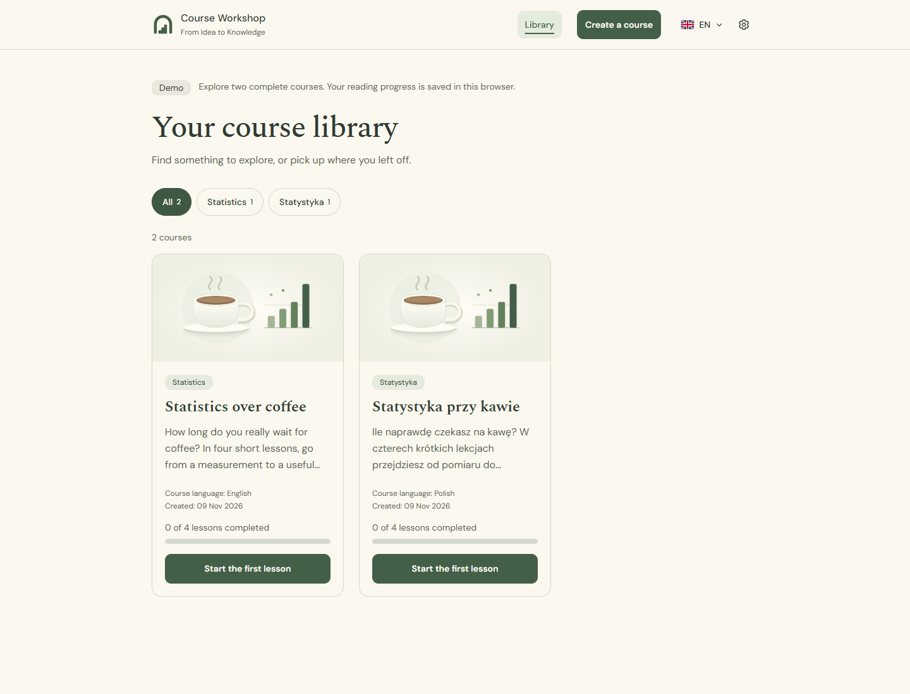
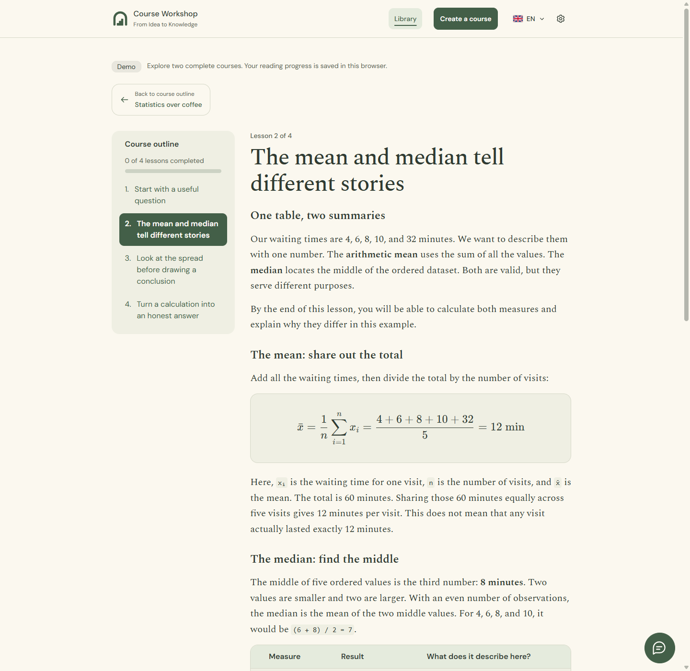
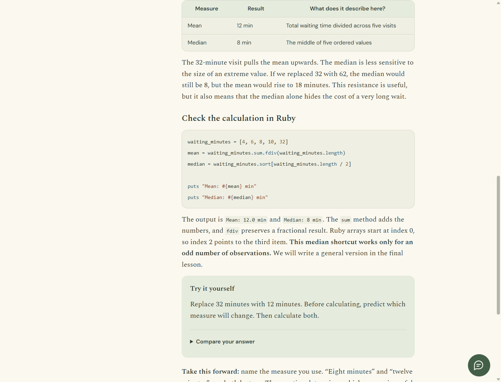
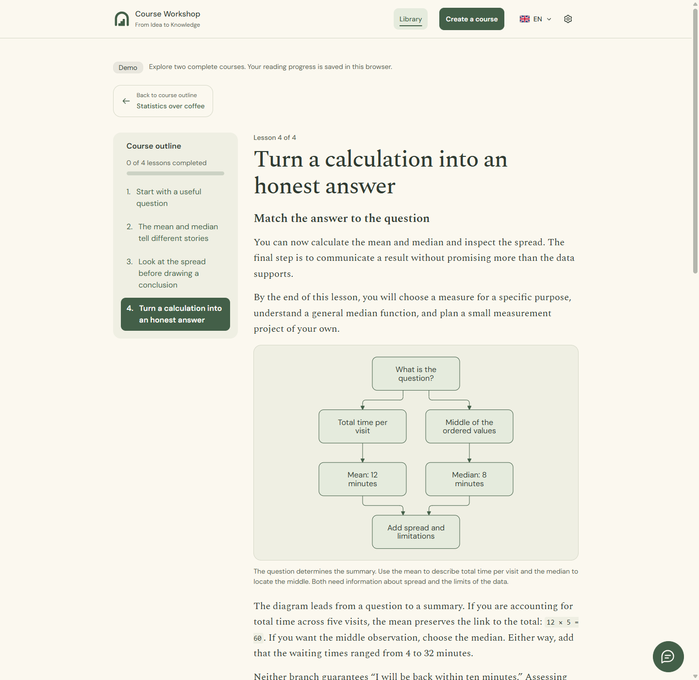

<p align="center">
  
</p>

# Course Workshop

**From Idea to Knowledge.** A bilingual workspace for creating, refining and studying structured courses with a local AI assistant.

Build a course from a topic, review its plan, and learn through lessons with code, mathematics, diagrams and exercises. Course Workshop combines a Rails application with a local Codex runtime; the prepared demo works without an AI account.

[Live demo](https://course-workshop-solvepatch.vercel.app/en) · [Documentation](docs/README.md) · [Run locally](#try-the-demo) · [Development setup](#development-setup) · [Design system](DESIGN.md) · [License](LICENSE)



## What you can do

- **Generate a structured course.** Describe a topic and learning goal. Review the proposed outline before the model writes lessons, then approve the finished draft before it enters the library.
- **Learn with varied material.** Read sanitized Markdown, highlighted code, LaTeX formulas, Mermaid diagrams, local images, tables and exercises with answers to reveal.
- **Keep your place.** Mark lessons complete, resume a course from the library, and update progress without losing your reading position.
- **Ask in context.** Open the floating assistant from an outline or lesson, quote a passage, and continue the same conversation while navigating. Accepted messages persist in PostgreSQL.
- **Refine a draft.** Ask the editor to revise material, add or reorder lessons, remove a lesson, or replace a cover. Inspect saved changes and undo eligible operations.
- **Choose how the model responds.** Select an available model, supported reasoning level and optional response style. Courses retain their original generation model, effort and date.
- **Use Polish or English.** Interface language and course language are independent. The Reading Room design uses warm paper, sage accents, accessible controls and reduced-motion support.

## Two operating modes

| | Local workspace | Demo |
| --- | --- | --- |
| Catalog | Your published courses and private local drafts | Two prepared courses, four lessons each |
| AI | Opt-in Codex integration, generation, tutoring and draft editing | Disabled, including server-side endpoints |
| Creation and settings | Editable when local AI is enabled | Visible, disabled previews |
| Assistant | Persistent conversations and scoped tools | Openable explanation with a disabled composer |
| Progress | One local profile by default; browser profiles optional | Separate progress for each browser |
| Media | Local Active Storage uploads and generated images | Versioned assets bundled with the application |

**The demo courses:** *Statystyka przy kawie* and *Statistics over coffee*. Both follow the same invented coffee waiting-time dataset, from measurement to an honest statistical conclusion. Each course includes a photograph, tables, a chart, Ruby examples, formulas, a flowchart and practice exercises.

## Try the demo

Explore the hosted demo in [English](https://course-workshop-solvepatch.vercel.app/en) or [Polish](https://course-workshop-solvepatch.vercel.app/pl). It runs on Vercel with Neon PostgreSQL. AI forms are disabled and each browser keeps its own progress. The first visit after inactivity may take longer while the application and database wake up.

With Docker running and Ruby available, run from the checkout:

```sh
ruby bin/demo
```

Open **[localhost:3001/en](http://localhost:3001/en)** or **[localhost:3001/pl](http://localhost:3001/pl)**.

The launcher builds the production image, creates a private `.env.demo` with random secrets, starts an isolated PostgreSQL service, and prepares both courses. Host Node.js, a Codex login and AI keys are not needed. Existing development data is not used. This command runs locally; it does not publish a website.

```sh
# Verify the running demo, including blocked writes and browser progress isolation
docker compose --env-file .env.demo -f compose.demo.yml exec web ruby bin/check-demo

# Stop it while keeping the database and progress
docker compose --env-file .env.demo -f compose.demo.yml stop
```

[`DEMO_MODE=true`](docs/demo.md#feature-gate) controls the feature boundary. See the [demo guide](docs/demo.md) for restart behavior, bundled media, environment variables and Vercel container deployment preparation.

## A focused reader

The outline stays beside the lesson, wide tables and code scroll within their own regions, and exercise answers use a native disclosure. Math and diagrams load only when needed. Progress updates preserve the lesson, open exercise and assistant state.



<details>
<summary>See code, tables and a diagram inside lessons</summary>





</details>

Screenshots come from the running demo. [Reproduce them](docs/screenshots/README.md) after UI changes.

## Development setup

| Dependency | Version / purpose |
| --- | --- |
| Ruby / Bundler | 4.0.9 / 4.0.20 |
| Node.js / npm | 24 / 11 |
| Docker Compose | PostgreSQL 18 |
| libvips | Image validation and processing |
| Chrome or Chromium | Browser tests |

On Windows, use RubyInstaller with MSYS2/Devkit. From a checkout:

```sh
ruby bin/setup
ruby bin/dev
```

Open [localhost:3000](http://localhost:3000). Setup installs dependencies, prepares the database and development seed, and builds assets. `bin/dev` runs Rails, the database-backed job worker, and asset watchers. AI is off by default.

To enable AI, follow [local Codex setup](docs/local-ai.md), then [course generation](docs/course-generation.md). The application checks the authenticated runtime's model catalog; GPT-6.1 Sol is the default. On Windows, `CODEX_EXECUTABLE=codex-desktop` follows installed desktop runtime updates. Generating text and images uses the connected Codex account's allowance.

The [development guide](docs/development.md) covers configuration, updates, troubleshooting and backups. Do not expose the development workspace through a public tunnel; its AI access is designed for a single local workspace.

## Architecture

| Layer | Implementation |
| --- | --- |
| Application | Ruby on Rails 8.1, ERB, Puma and PostgreSQL |
| Interface | Turbo, Stimulus, Tailwind CSS, daisyUI and Rails I18n |
| Lesson rendering | Commonmarker, Rouge, KaTeX, Mermaid and DOMPurify |
| Background work | Solid Queue, persisted execution state, scoped credentials and idempotent operation receipts |
| AI boundary | Local Codex App Server plus narrowly scoped MCP tools |
| Media | Active Storage; local uploads or read-only bundled demo assets |

Generation, editing and images run outside database transactions. Short locked transitions and revision checks coordinate writes; uncertain interrupted work is reconciled before an explicit retry. Published tutors have no editing tools. Plan approval and library publication remain human actions.

See the [architecture guide](docs/architecture.md) for request flow, records, recovery and access boundaries, and the [documentation index](docs/README.md) for individual feature contracts.

## Verification

```sh
ruby bin/rails test
ruby bin/rails test:system
ruby bin/rails zeitwerk:check
ruby bin/rubocop
ruby bin/brakeman --no-pager
ruby bin/bundler-audit
npm audit
```

Automated AI tests use fake adapters and do not call a model. [CI](.github/workflows/ci.yml) checks Ruby style, application security, dependencies, application/browser behavior, and a fresh production demo build. Browser tests cover Polish/English, keyboard use, narrow layouts and recovery scenarios.

## Current scope

The local workspace is for a single owner. Demo progress is anonymous browser continuity, with no login or cross-device synchronization. Clearing the identity cookie starts a new profile. Demo charts are static; arbitrary generated JavaScript, interactive Chart.js lessons and automatic imports of web images are not implemented. Generated material still needs human review.

## License and contributions

Source available under the **[PolyForm Noncommercial License 1.0.0](LICENSE)**. Use, modification and redistribution must comply with its permitted purposes and conditions. [Third-party assets and dependencies retain their own licenses](NOTICE).

This repository **does not accept external contributions or pull requests**. See the [contribution policy](CONTRIBUTING.md).
