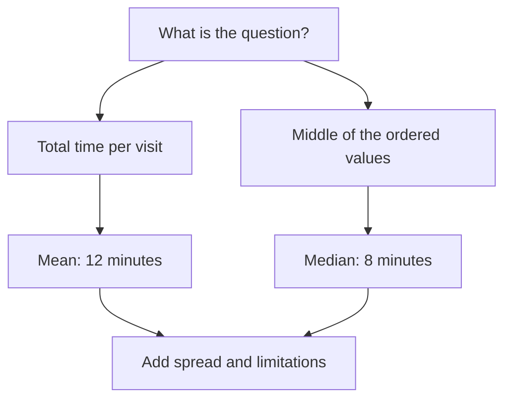

## Match the answer to the question

You can now calculate the mean and median and inspect the spread. The final step is to communicate a result without promising more than the data supports.

By the end of this lesson, you will choose a measure for a specific purpose, understand a general median function, and plan a small measurement project of your own.



The diagram leads from a question to a summary. If you are accounting for total time across five visits, the mean preserves the link to the total: `12 × 5 = 60`. If you want the middle observation, choose the median. Either way, add that the waiting times ranged from 4 to 32 minutes.

Neither branch guarantees “I will be back within ten minutes.” Assessing future visits calls for more comparable data and knowledge of whether conditions have changed.

## A median for any number of observations

This function accepts a non-empty array of numbers. It leaves the original array unchanged. For an odd number of items, it returns the middle one. For an even number, it returns the mean of the two middle values.

```ruby
def median(values)
  raise ArgumentError, "Provide at least one value" if values.empty?

  sorted = values.sort
  middle = sorted.length / 2
  return sorted[middle] if sorted.length.odd?

  (sorted[middle - 1] + sorted[middle]).fdiv(2)
end

puts median([4, 6, 8, 10, 32]) # 8
puts median([10, 4, 8, 6])     # 7.0
```

Notice the second example: the input need not already be ordered. An empty array raises a clear error instead of pretending that the answer is 0. This course assumes that the values are numbers. Data submitted through a form would also require checks on types and allowed values.

```exercise
{"prompt":"Write a short answer for someone planning a coffee break. Include the number of measurements, median, mean, longest visit, and one limitation. Try your own wording before revealing the example.","answer":"For example: “Across five example measurements, the median was 8 minutes and the mean was 12. The longest visit took 32 minutes, so a ten-minute break did not accommodate every visit. This is a small, invented teaching dataset, not a forecast for a real café.”"}
```

## Your own small experiment

1. Choose a repeatable activity, such as making tea.
2. Write down the starting point, stopping point, and unit of measurement.
3. Collect several observations, noting changes in conditions.
4. Calculate the mean and median. Draw bars from a shared zero or list the values in a table.
5. Write two sentences: what the data shows, and what you still do not know.

**Completing the course does not require running code.** You can do the calculations by hand. When you finish, mark the lesson complete; your progress will appear in the outline and library.

The main skill in this course is more than remembering a formula. It is moving from a clearly defined measurement to an answer whose scope fits the available evidence.
