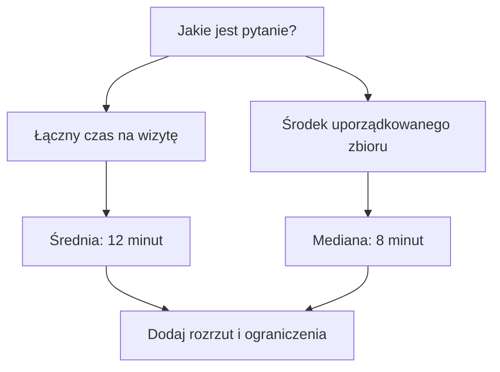

## Dobierz odpowiedź do pytania

Potrafisz już obliczyć średnią i medianę oraz zobaczyć rozrzut. Ostatni krok to przekazanie wyniku bez obiecywania więcej, niż pokazują dane.

Po tej lekcji wybierzesz miarę do konkretnego celu, uruchomisz ogólną funkcję mediany i zaplanujesz własny mały pomiar.



Diagram prowadzi od pytania do podsumowania. Jeśli rozliczasz łączny czas pięciu wizyt, średnia zachowuje powiązanie z sumą: `12 × 5 = 60`. Jeśli szukasz środkowej obserwacji, wybierz medianę. W obu przypadkach dopowiedz, że czasy wyniosły od 4 do 32 minut.

Żadna gałąź nie daje gwarancji „zdążę w dziesięć minut”. Do oceny przyszłych wizyt potrzebujesz więcej porównywalnych danych oraz informacji, czy zmieniły się warunki.

## Mediana dla dowolnej liczby obserwacji

Poniższa funkcja przyjmuje niepustą tablicę liczb. Nie zmienia oryginalnej tablicy. Przy nieparzystej liczbie elementów zwraca środkowy, a przy parzystej — średnią dwóch środkowych.

```ruby
def median(values)
  raise ArgumentError, "Provide at least one value" if values.empty?

  sorted = values.sort
  middle = sorted.length / 2
  return sorted[middle] if sorted.length.odd?

  (sorted[middle - 1] + sorted[middle]).fdiv(2)
end

puts median([4, 6, 8, 10, 32]) # 8
puts median([10, 4, 8, 6])     # 7.0
```

Zwróć uwagę na drugi przykład: wejście nie musi być uporządkowane. Pusta tablica wywołuje czytelny błąd zamiast pozornej odpowiedzi 0. W tym kursie zakładamy, że wartości są liczbami; przy danych z formularza należałoby dodatkowo sprawdzić typy i dopuszczalne wartości.

```exercise
{"prompt":"Napisz krótką odpowiedź dla osoby planującej przerwę na kawę. Uwzględnij liczbę pomiarów, medianę, średnią, najdłuższą wizytę i jedno ograniczenie. Najpierw ułóż własne zdania.","answer":"Przykład: „W pięciu przykładowych pomiarach mediana wyniosła 8 minut, a średnia 12 minut. Najdłuższa wizyta trwała 32 minuty, więc dziesięciominutowa przerwa nie pomieściła każdej z nich. To wymyślony, mały zbiór dydaktyczny, a nie prognoza czasu w prawdziwej kawiarni”."}
```

## Twój mały eksperyment

1. Wybierz powtarzalną czynność, na przykład parzenie herbaty.
2. Zapisz regułę początku i końca pomiaru oraz jednostkę.
3. Zbierz kilka obserwacji, zachowując notatki o zmianach warunków.
4. Policz średnią i medianę. Narysuj słupki od wspólnego zera albo wypisz wartości w tabeli.
5. Napisz dwa zdania: co pokazują dane i czego jeszcze z nich nie wiesz.

**Ukończenie kursu nie wymaga uruchomienia kodu.** Możesz wykonać obliczenia ręcznie. Gdy skończysz, oznacz lekcję jako ukończoną; postęp będzie widoczny w planie i bibliotece.

Najważniejsza umiejętność z tego kursu to nie sam wzór. To przejście od jasno zdefiniowanego pomiaru do odpowiedzi, której zakres pasuje do posiadanych danych.
