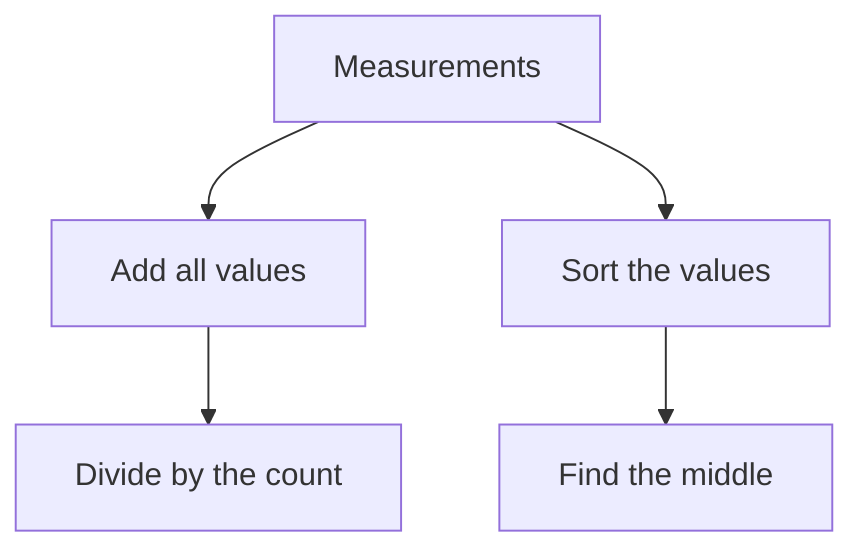

# Math, diagrams, and practice exercises

Lessons support three fenced block types: `math`, `mermaid`, and `exercise`. They are data formats, not a way to insert scripts or arbitrary HTML. The same validation applies to prepared material and future generated lessons.

## Display math

Write KaTeX-compatible LaTeX inside a `math` fence, without dollar delimiters:

````markdown
```math
\bar{x} = \frac{1}{n}\sum_{i=1}^{n}x_i
```
````

Describe the variables in nearby prose. Each block supports up to 2,000 characters. Inline dollar notation is not interpreted. Code samples using other fence names remain ordinary code.

The browser renders HTML with MathML for assistive technology. Trust is disabled, malformed or unsupported expressions produce a localized fallback, macro expansion is bounded, and size commands are limited. URL, image, and HTML styling commands are rejected by the server. A fresh macro dictionary is used for each expression.

## Flow diagrams

The reader accepts a deliberately small subset of Mermaid flowcharts:

````markdown

````

Supported syntax:

- Start with `flowchart TD` or `flowchart LR`.
- Define each node on its own line as `A["A label"]` or `A{"A question?"}`.
- Connect declared nodes with `A --> B` or `A -->|Yes| B`.
- Include exactly one single-line `accDescr:` description. It becomes a visible caption and an accessible SVG description.

Limits are 6,000 source characters, 24 nodes, and 32 edges. Node IDs start with an ASCII letter, followed by letters, digits, or underscores, up to 40 characters. Node labels have at most 180 characters, edge labels 80, and the description 600. Labels and descriptions allow Unicode letters, numbers, ordinary spaces, and `.,;:!?%+=()/-`.

Other Mermaid diagram types, comments, front matter, configuration directives, styles, HTML, Markdown labels, icons, links, and click callbacks are outside this format. Unknown or duplicate nodes are rejected. A syntax error that reaches Mermaid still produces a fallback rather than breaking the lesson.

The application owns the Reading Room theme and enables Mermaid's strict security mode with HTML labels disabled. SVG output is sanitized with DOMPurify before insertion; links, external images, scripts, and foreign HTML containers are removed. Diagram containers scroll horizontally when necessary, preserving legible labels on narrow screens.

## Practice exercises

An exercise contains a JSON object with exactly two nonempty strings: `prompt` and `answer`.

````markdown
```exercise
{
  "prompt": "For **4, 6, 8, 10, 32**, calculate the mean and median.\n\nExplain why they differ.",
  "answer": "The mean is **12** and the median is **8**.\n\nThe longest journey changes the sum but not the middle observation."
}
```
````

Use JSON escapes such as `\n` for newlines. The whole block is limited to 10,000 characters and each field to 4,000. Both fields support the existing sanitized Markdown and local-image rules. Special learning blocks inside these fields remain code, avoiding recursive components.

A native `details` disclosure keeps the answer collapsed until the reader selects **Compare your answer**. It works with the keyboard and without JavaScript. These are self-check exercises: the answer is already part of the delivered page, there is no grading, and opening the solution does not mark the lesson complete.

## Failure behavior and assets

A lesson renders at most 32 special blocks. Invalid blocks show a localized notice with an optional escaped source preview; the rest of the lesson stays readable. If JavaScript or a renderer fails, math and diagram blocks retain their escaped source. Interface notices follow PL/EN; lesson text retains its original language.

Stimulus loads a renderer only when its block connects. A generation check prevents late asynchronous results from updating a disconnected or restored Turbo page. Each diagram has a unique SVG ID and its temporary rendering container is removed after completion or failure.

esbuild builds separate renderer entry points and shared chunks. Rails supplies the entry-point URLs through Propshaft, while chunk and font filenames include their content hashes and the `.digested` marker to preserve cross-file imports. KaTeX CSS and fonts are served locally. No CDN is required. The library page does not load either renderer.

## Verification

The second lesson of the seeded statistics course includes all three blocks. Run `ruby bin/rails db:seed` to refresh it. Automated tests cover valid and invalid formats, URL/HTML/configuration injection attempts, bounded input, keyboard disclosure, Turbo navigation, narrow-screen overflow, and independent render failures.

```sh
ruby bin/rails test:all
```

The production asset build must also resolve the renderer modules, shared chunks, KaTeX CSS, and fonts. This is particularly important after changing esbuild output names or the Propshaft integration.

Implementation references: [KaTeX options](https://katex.org/docs/options.html), [Mermaid usage](https://mermaid.js.org/config/usage.html), and [DOMPurify configuration](https://github.com/cure53/DOMPurify#can-i-configure-dompurify).
